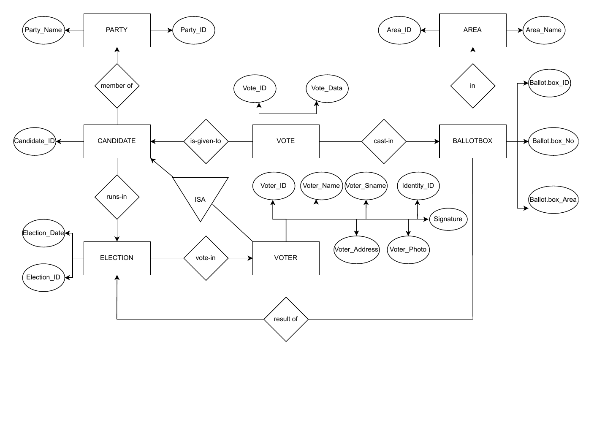
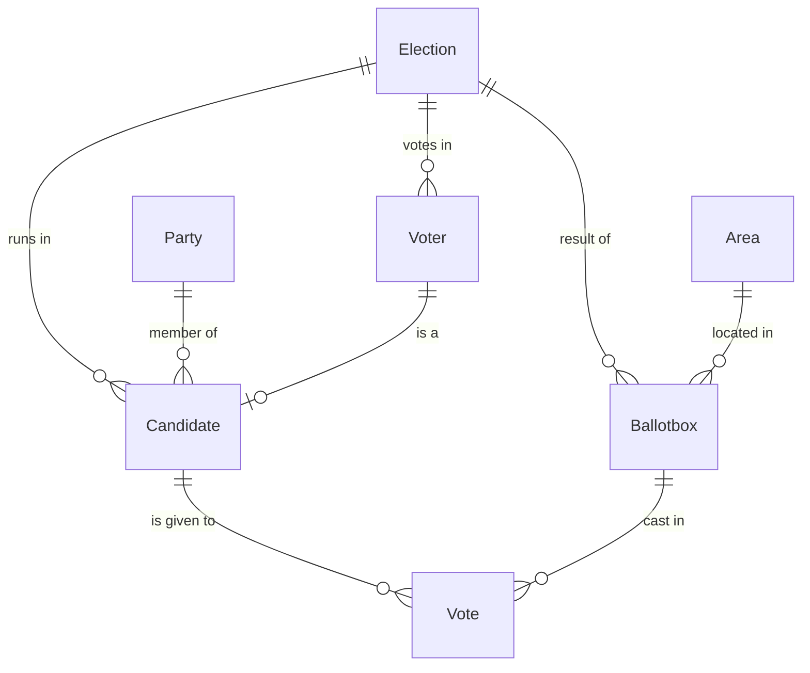

# Election Database

A relational database design for modelling an election: voters, candidates, parties, districts, ballot boxes and votes. Written in **T-SQL (Microsoft SQL Server)** as a database course project, starting from an entity–relationship (Chen) diagram.

> All sample data is **fictional** (made-up people, parties and IDs).

## Entity–relationship diagram

Original Chen diagram drawn during the design phase ([PDF](docs/chen-diagram.pdf)):



The same model as implemented in SQL (relationships follow the foreign keys):



## Tables

| Table | Purpose |
|---|---|
| `Election` | An election and its date |
| `Voter` | Registered voter: name, signature picture, citizenship id, address |
| `Party` | Political party (unique name); a row for independent candidates |
| `Candidate` | A voter who runs for a party in an election (*Candidate is-a Voter*) |
| `Area` | District in which ballot boxes are placed |
| `Ballotbox` | A ballot box in an area for an election |
| `Vote` | A single vote: which candidate, in which ballot box |

## Design notes

- **Specialisation** is modelled with `Candidate.voter_id`, so a candidate is always an existing voter.
- `citizenship_id` is a `BIGINT` instead of a string — a numeric id needs far less storage.
- `Party.P_Name` was widened to `VARCHAR(150)` because some party names are long, and is `UNIQUE`.
- The `ballotBox_no` column was dropped: the surrogate `id` already identifies a ballot box.
- The schema in `01_schema.sql` is the consolidated final state of the incremental `ALTER TABLE` scripts written during the course.

## Getting started

Requires Microsoft SQL Server (e.g. the free Developer/Express edition) with SQL Server Management Studio or Azure Data Studio. Run the scripts in order:

```text
sql/01_schema.sql      -- creates the database and tables
sql/02_seed_data.sql   -- inserts fictional sample data (1 election, 9 voters, 39 districts, 8 votes)
sql/03_queries.sql     -- example queries and a view
```

## What the queries demonstrate

`MAX` / `MIN`, `IN`, `BETWEEN`, `DISTINCT` with `COUNT`, `ORDER BY`, `GROUP BY` with `HAVING`, `TOP`, inner joins across up to three tables, and `CREATE VIEW` / `ALTER VIEW`.

## Repository layout

```text
.
├── docs/
│   ├── chen-diagram.pdf
│   └── chen-diagram.png
└── sql/
    ├── 01_schema.sql
    ├── 02_seed_data.sql
    └── 03_queries.sql
```

## License

[MIT](LICENSE) © 2026 İsa Efe
